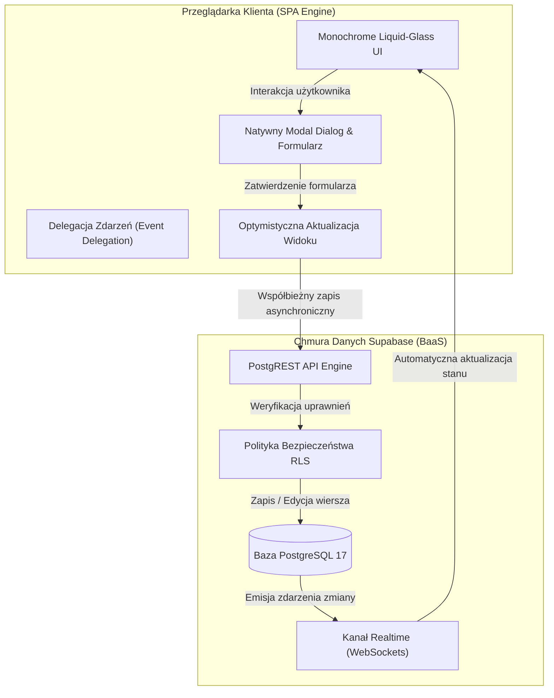

<div align="center">

# zzcms

**Monochrome Liquid-Glass Single Page Application for Academic Notes & Source Code Archival**

[](https://zzcms.vercel.app)
[](https://supabase.com)
[](https://developer.mozilla.org/en-US/docs/Web/JavaScript)
[](https://developer.mozilla.org/en-US/docs/Web/CSS/backdrop-filter)
[](https://github.com/RobertBudnik/zzcms)

<br/>

**[Dostęp Produkcyjny: zzcms.vercel.app](https://zzcms.vercel.app)** &nbsp;&bull;&nbsp; **[Kod Źródłowy: GitHub](https://github.com/RobertBudnik/zzcms)**

</div>

---

## 1. Wprowadzenie i Filozofia Projektowa

**zzcms** to lekka, bezframeworkowa aplikacja typu Single Page Application (SPA) zrealizowana w surowej estetyce **Liquid-Glass (Glassmorphism)** i ścisłej skali monochromatycznej (Black & White). Projekt powstał jako cyfrowe środowisko akademickie dedykowane studentom do systematycznego katalogowania materiałów z wykładów i laboratoriów, rejestrowania poleceń terminala i kodu źródłowego oraz monitorowania postępów dydaktycznych.

### Założenia wizualne i standard wykonania
- **Zero AI-Slop**: Całkowita rezygnacja z powtarzalnych, nasyconych gradientów (purple/cyan), zbędnych rozmytych kul tła i generycznych komponentów bibliotecznych.
- **Czysta Paleta Monochromatyczna**: Dominacja głębokiej czerni OLED (`#000000`), wielopoziomowe przezroczystości bieli (`rgba(255, 255, 255, 0.05)` do `0.15`) oraz kontrastowy tekst (`#f5f5f5` i `#a3a3a3`).
- **Głęboki Liquid-Glass**: Zastosowanie sprzętowo akcelerowanego rozmycia `backdrop-filter: blur(16px)`, mikroskopijnych krawędzi zwierciadlanych (1px specular border) oraz subtelnych cieni rozproszonych.
- **Szwajcarska Typografia**: Czysty stos systemowy (`system-ui, -apple-system, sans-serif`) połączony z blokami o stałej szerokości znaków (`monospace`) dla fragmentów kodu i poleceń bash.

---

## 2. Stos Technologiczny i Architektura

Aplikacja została zbudowana bez narzutu ciężkich bibliotek frontendowych — opiera się wyłącznie na natywnych standardach platformy webowej oraz chmurowym backendzie PostgreSQL.

| Warstwa | Technologia | Zastosowanie architektoniczne |
| :--- | :--- | :--- |
| **Frontend Runtime** | Pure Vanilla HTML5 & ES6+ | Pełna niezależność od bibliotek zewnętrznych, natywny element `<dialog>`, delegacja zdarzeń (`Event Delegation`), optymistyczne aktualizacje UI. |
| **System Stylów** | Modern CSS3 | Zmienne CSS (`:root`), responsywny CSS Grid (`auto-fill`, `minmax`), sprzętowo akcelerowany `backdrop-filter`, brak preprocesorów. |
| **Baza Danych (BaaS)** | Supabase (PostgreSQL 17) | Trwały relacyjny magazyn danych, relacyjne tabele z kluczem głównym, mechanizm Row Level Security (RLS). |
| **Komunikacja & Realtime** | Supabase JS Client & WebSockets | Asynchroniczna komunikacja REST (PostgREST) oraz natychmiastowa re-synchronizacja zmian pomiędzy wieloma oknami i urządzeniami. |
| **Hosting & CI/CD** | Vercel Edge Platform | Globalna sieć dystrybucji CDN, automatyczny proces wdrażania, obsługa HTTPS z certyfikacją SSL/TLS. |

---

## 3. Schemat Przepływu Danych



---

## 4. Główne Moduły i Funkcjonalności

- **System Uwierzytelniania Administratora (Role-Based View)**:
  - **Tryb Gościa / Wykładowcy (Public Read-Only)**: domyślny tryb dla osób odwiedzających portfolio. Zapewnia przejrzysty, bezpieczny wgląd we wszystkie materiały, kod i notatki, ukrywając przyciski modyfikacji.
  - **Tryb Administratora (Full Control)**: odblokowuje przyciski tworzenia (`+ Dodaj nową lekcję`), kafelkowy stub w siatce oraz akcje na kartach (edycja `✏️`, oznaczanie opanowania `⚡`, usuwanie `🗑`).
  - **Dane dostępowe**:
    - Login: `rbudnik`
    - Hasło: `zniwna112bc`
  - Trwałość sesji oparta o bezpieczną pamięć podręczną przeglądarki (`localStorage`).
- **Kompletny Cykl CRUD w Czasie Rzeczywistym**:
  - Tworzenie nowych notatek z przypisaniem przedmiotu, daty, treści i tagów.
  - Wbudowany tryb edycji: dwukierunkowe wiązanie formularza przywraca surowy stan z ukrytego elementu `<template class="raw-data">`.
  - Usuwanie kafelków z natychmiastowym wyczyszczeniem wpisu w bazie PostgreSQL.
- **Dedykowany Kontener Kodu Źródłowego**:
  - Pole `.code-input` z czcionką o stałej szerokości (`monospace`) przystosowane do wklejania zapytań SQL, skryptów Bash, konfiguracji Docker i bloków kodu.
  - Wbudowane zabezpieczenie przed atakami XSS poprzez bezpieczną konwersję encji znakowych HTML przed wstrzyknięciem do DOM.
- **Zarządzanie Stanem Opanowania Materiału**:
  - Dedykowany przełącznik stanu (symbol pioruna) pozwalający oznaczyć partię materiału jako zrealizowaną/opanowaną (efekt przyciemnienia i redukcji przezroczystości kafelka z utrwaleniem w bazie).
- **Formatowanie Notatek i Odnośników**:
  - Właściwość `white-space: pre-wrap` gwarantująca zachowanie formatowania, list i akapitów z pola tekstowego.
  - Automatyczne parsowanie linków zewnętrznych do postaci estetycznych, klikalnych kapsułek referencyjnych.

---

## 5. Schemat Bazy Danych i Bezpieczeństwo (SQL)

Struktura tabeli została zdefiniowana w środowisku PostgreSQL w chmurze Supabase z aktywną polityką dostępu:

```sql
-- Utworzenie tabeli materiałów dydaktycznych
create table if not exists lessons (
  id text primary key,
  title text not null,
  subject text,
  date text,
  notes text,
  code text,
  links text,
  tags text,
  completed boolean default false,
  created_at timestamp with time zone default timezone('utc'::text, now()) not null
);

-- Włączenie mechanizmu Row Level Security (RLS)
alter table lessons enable row level security;

-- Konfiguracja otwartej polityki odczytu i zapisu dla instancji dydaktycznej
create policy "Enable all access for lessons"
on lessons for all
using (true)
with check (true);
```

---

## 6. Struktura Katalogów Projektu

```
zzcms/
├── .gitignore              # Konfiguracja wykluczeń gita (.DS_Store, .vercel, node_modules)
├── index.html              # Główny szkielet aplikacji z klientem Supabase CDN
├── style.css               # System zmiennych CSS, stylistyka Liquid-Glass, układ Grid
├── app.js                  # Logika biznesowa, obsługa CRUD, Event Delegation, Realtime
└── README.md               # Kompleksowa dokumentacja techniczna i architektoniczna
```

---

## 7. Uruchomienie Lokalne i Wdrożenie

### Klonowanie repozytorium
```bash
git clone https://github.com/RobertBudnik/zzcms.git
cd zzcms
```

### Uruchomienie lokalnego serwera deweloperskiego
Aplikacja jest w pełni statyczna i nie wymaga instalacji pakietów npm:

```bash
# Opcja A: Poprzez Node.js serve
npx serve .

# Opcja B: Poprzez wbudowany serwer Python
python3 -m http.server 3000

# Opcja C: Bezpośrednie otwarcie w przeglądarce
open index.html
```

### Wdrożenie na platformę Vercel
```bash
# Logowanie i publikacja produkcyjna
vercel --prod
```

---

## 8. Informacje o Projekcie

- **Autor**: Robert Budnik
- **Projekt**: zzcms — System Notatek i Warsztat Laboratoryjny CMS
- **Środowisko Produkcyjne**: [https://zzcms.vercel.app](https://zzcms.vercel.app)
- **Repozytorium Kodów**: [https://github.com/RobertBudnik/zzcms](https://github.com/RobertBudnik/zzcms)
